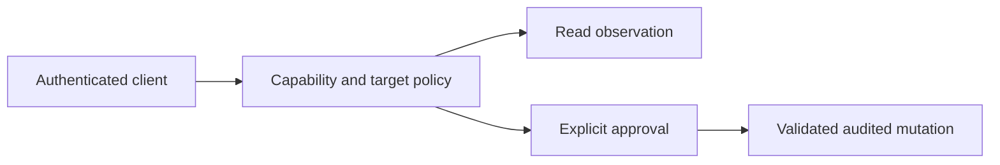

# Gateway runtime contract

- Status: As-built baseline
- Date: 2026-10-21
- Catalog capability ID: home-assistant-gateway
- Last verified: 2026-10-21
- Owners: Gateway maintainers
- Scope: Gateway runtime contract
- Related issues/PRs: https://github.com/vypdev/homeassistant-gateway/issues/19
- Required review gates: architecture, testing, documentation, security/operations
- Open decisions blocking readiness: none; human PR review and rollout remain pending

## 1. Executive summary

Home Assistant Gateway exposes authenticated, capability-scoped observation and explicit operator execution through a Supervisor App or standalone container. Observer access MUST remain read-only.

## 2. Problem, current behavior, and evidence

Observed behavior: application ports isolate policy from provider adapters; HTTP and MCP expose the same authorization boundary. Intentional contract: preserve explicit operator policy, approval, idempotency and audit. Known debt and limitations: local development jobs are process-local. Unknown rationale: historical release branch naming. Proposed improvements: repository automation is specified separately.

## 3. Actors, surfaces, and terminology

Home Assistant users provision clients in the administration console. MCP clients use issued credentials. Maintainers operate CI and publication; the model cannot grant operator access.

## 4. Goals, non-goals, and fixed invariants

Preserve existing public MCP names, capability identifiers, secrets handling and layer direction. This maintenance change MUST NOT add Docker socket, SSH, shell or arbitrary Home Assistant filesystem access to the product.

## 5. Current versus proposed product journey

The runtime journey is unchanged.

Text equivalent: authenticate, authorize, then observe or explicitly approve and execute an audited mutation.

## 6. Functional behavior and state model

Clients authenticate and receive only their effective capabilities. Operator requests validate target and input, retain approval and idempotency facts, and record an audit result. Failed authorization does not call Home Assistant.

## 7. User-facing configuration

Observer is the recommended default. Operator and execution settings are explicit. Existing documented bounds in docs/operator-profile.md and docs/security-model.md remain authoritative.

## 8. Clean Architecture design

Presentation maps requests to application use cases; domain owns decisions; infrastructure implements Home Assistant, storage and transports; composition wires adapters. tests/test_repository_contract.py checks import cycles.

## 9. UI/UX and content contract

Pending: an authorized request is running. Action required: approve an allowed mutation. Blocked: policy or validation denies it. Partial: retain audit evidence when an external effect is uncertain. Complete: show the verified result. Keep translated, accessible console feedback.

## 10. Failure, recovery, and cleanup

Expose bounded sanitized provider errors. Preserve completed effects and audit facts on retries. Never infer successful execution from an empty provider response or a model statement.

## 11. Security, permissions, and privacy

Credentials MUST be absent from public errors and audit payloads. Enforce identity, capability, target policy, input validation, approval, idempotency and audit before operator mutations.

## 12. Observability and operational UX

Development reports and audit entries distinguish verified results from unavailable evidence. Follow docs/development-console-traceability.md for report behavior and retention limits.

## 13. Compatibility, migration, rollout, and rollback

Support Supervisor and standalone deployment through the same policy ports. Preserve public tools and capability IDs. Repository automation migration does not authorize a runtime deployment.

## 14. Testing strategy and numeric budget

| Area | Minimum distinct cases | Evidence |
|---|---:|---|
| Authentication and authorization | 12 | Authentication, authorization and policy tests |
| Mutation denial and execution | 12 | Operator security, preview and mutation tests |
| Provider and presentation contracts | 16 | HTTP, MCP and adapter tests |
| **Total** | **40** | Existing cases; no double counting |

Keep the 85% repository backend coverage gate and frontend/browser checks.

## 15. Documentation and discoverability

User and operator guidance lives in README.md, docs/security-model.md, docs/operator-profile.md and docs/consumer/. Architecture ownership lives in AGENTS.md and docs/architecture.md.

## 16. Acceptance scenarios

Given an observer credential, mutation attempts are denied before provider calls. Given an unapproved operator request, execution is denied. Given a repeated approved request, idempotency prevents duplicate execution. Given provider failure, errors exclude credentials. Given this maintenance PR, public runtime capabilities remain unchanged.

## 17. Requirements traceability

| Requirement | Test/evidence | Documentation |
|---|---|---|
| Read-only observer | tests/test_observer.py; tests/test_authorization.py | docs/security-model.md |
| Explicit mutation guards | tests/test_operator_security.py; tests/test_operator_mutations.py | docs/operator-profile.md |
| No provider coupling or extra host capabilities | tests/test_repository_contract.py | AGENTS.md |

## 18. Implementation sequence

This baseline records existing behavior. Future changes first update the owning contract and focused failing tests, then application policy, adapters, boundary tests and documentation.

## 19. Definition of Done

Require security and architecture invariants, meaningful denial/error tests, the full suite and existing quality gates. Validate catalog evidence with python -m scripts.check_specifications. Human review owns intentional contract changes.

## 20. References and decisions

Evidence: src/homeassistant_gateway/domain/policy.py, application/operator_mutations.py, presentation/mcp.py and the registered tests. Repository automation belongs to specs/repository-automation.md.
