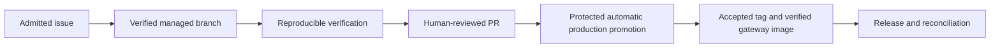

# Gateway repository automation

- Status: Draft
- Date: 2026-10-21
- Catalog capability ID: repository-automation
- Last verified: 2026-10-25
- Owners: Gateway maintainers
- Scope: Gateway repository automation
- Related issues/PRs: https://github.com/vypdev/homeassistant-gateway/issues/19
- Required review gates: architecture, testing, documentation, security/operations
- Open decisions blocking readiness: none; human review, default/development rollout and operator prerequisites remain pending

## 1. Executive summary

Make managed contributor work verifiable and let explicitly authorized releases publish the accepted gateway image through one owner. Required checks MUST cover master and develop without weakening coverage.

## 2. Problem, current behavior, and evidence

Production moved to master while CI/Edge retained main. SDD was enabled without prerequisites. The real sync run 39570398824 aborted because pytest was missing. Release templates had no gateway preparation and competed with the legacy tag publisher.

## 3. Actors, surfaces, and terminology

Maintainers start admitted issues with in-progress. Copilot owns managed branches and lifecycle. Contributors push normal commits to the linked branch and request human review. Only explicit release/hotfix launch authorizes publication.

## 4. Goals, non-goals, and fixed invariants

Keep master production and develop development. Preserve the original managed branch and issue. Never force-push, invent readiness labels or infer deployment authorization from a model or tool name. This PR does not launch publication.

## 5. Current versus proposed product journey

Text equivalent: issue, branch, checks, review, authorized accepted tag, image verification, release and reconciliation.

## 6. Functional behavior and state model

CI produces test, frontend and app-packaging on production/development PRs and merge groups. Generated comment workflows retain their operator-provisioned runtime contract; their YAML is unchanged. Release/hotfix preparation updates metadata and validates it. Publication completion MUST depend on successful image build, scan and smoke checks.

The ordinary backend suite checks the real package, Stable, Edge and changelog metadata against the current changelog version. A temporary copy of the checked-out metadata and pinned examples exercises the next patch preparation and matching replay while preserving the source checkout.

## 7. User-facing configuration

Use inherited master/develop branch roles and the installed issue profile. Declare Python 3.11, Node 22 and pnpm 11.15.1 in verification-prerequisites.json. Resolve pnpm through the frontend packageManager using Corepack. Keep approval mode recommend.

Recommendation prerequisites include `info` Bugbot severity, trusted `CI` producers for test/frontend/app-packaging from GitHub Actions (15368), and stale-approval dismissal on develop. The tracked setup policy and live repository settings must agree.

## 8. Clean Architecture design

Repository-only scripts adapt fixed metadata files and existing application tests; application/domain code is unchanged. The local setup action owns tool preparation in release/hotfix and image jobs only. Copilot owns authorization, durable deployment state and accepted tag creation. The reusable publisher owns GHCR images only.

## 9. UI/UX and content contract

Pending: checks or runner capacity is outstanding. Action required: review the exact PR. Blocked: a declared runtime or verification fails. Partial: a tag or image exists while publication verification is incomplete. Complete: the accepted image passes its checks and Copilot records publication. Link the existing issue and retained operation.

## 10. Failure, recovery, and cleanup

Failed checks MUST prevent trusted automated commit/push. Publication failure retains existing accepted tag and state; retry the same operation. Never dispatch a second deployment or replace managed refs as recovery. Version preparation is idempotent for matching notes and rejects conflicting replay.

## 11. Security, permissions, and privacy

Never pass PAT or model keys to dependency installation or verification. Use bounded calls and sanitized errors. The reviewed self-hosted vypdev routes execute CI: Linux for backend/automation, ARM64 macOS for Docker-dependent packaging and browser jobs. Same-repository PR guards reject fork code before allocation. Linux browser snapshots and every browser/suite remain inside the pinned Playwright Docker image; persistent trusted writers remain within the operator trust boundary.

## 12. Observability and operational UX

Use exact static required job names and Action summaries. Distinguish queued capacity, failed checks and unavailable credentials. Retain current-head CI and Bugbot evidence; a green metadata observer is not a model smoke or publication certificate.

## 13. Compatibility, migration, rollout, and rollback

First merge the reviewed default-branch configuration, then use the protected Action/maintainer backmerge to install it on develop. Leave existing operations on their verified refs. Keep release publication exclusively behind orchestration. Restore a reviewed workflow revision to roll back configuration.

## 14. Testing strategy and numeric budget

| Area | Minimum distinct cases | Behaviors |
|---|---:|---|
| Workflow and setup contracts | 12 | Required checks, runner and publication ownership |
| Release metadata policy | 17 | Versions, denial paths and replay |
| Catalog and path boundaries | 8 | Structure, evidence and unsafe paths |
| Registry identity and retries | 12 | Immutable versions, platform completeness and sanitized failures |
| **Total** | **49** | Distinct focused regression cases |

Keep the complete existing backend, frontend, Storybook, browser and packaging gates.

## 15. Documentation and discoverability

Document normal contribution, verification preparation, default-branch rollout, development backmerge, explicit publication and recovery in docs/repository-automation.md and docs/release-channels.md. Keep AGENTS.md commands executable.

## 16. Acceptance scenarios

Given a PR targeting master or develop, all required jobs run. Given enabled SDD, catalog/standard/template validate. Given a missing runtime, verification fails before publish. Given invalid or older metadata, preparation writes nothing. Given conflicting replay notes, preparation rejects them. Given a failed image scan/smoke, release completion does not run. Given a normal PR, no stable image publisher runs.

Given inconsistent checked-out release versions, the backend gate fails even when synthetic preparation fixtures are valid. Given a consistent checkout, its temporary copy prepares and validates the next patch and replays unchanged; independent package, Stable, Edge and changelog drift is rejected without partial preparation.

## 17. Requirements traceability

| Requirement | Evidence | Documentation |
|---|---|---|
| Required CI | tests/test_copilot_workflows.py | docs/repository-automation.md |
| Safe preparation/replay | tests/test_prepare_release.py | docs/release-channels.md |
| Real repository metadata consistency and preparation | tests/test_prepare_release.py | docs/repository-automation.md |
| Catalog boundaries | tests/test_specifications.py | specs/README.md |
| Verified publication ordering | tests/test_copilot_workflows.py | docs/repository-automation.md |

## 18. Implementation sequence

Record the observed contract, reproduce failures, add bootstrap and metadata policies, wire workflows, validate SDD and docs, run quality gates, review the diff and prepare the PR. Record authorized exceptional bootstrap recovery without replacing the managed branch.

## 19. Definition of Done

All focused tests, the full suite, coverage, frontend/browser/packaging checks, specification validation and diff checks pass. No credentials or generated build output enter the diff. Required checks and human review remain mandatory. Actual release publication is a later explicitly authorized operation.

## 20. References and decisions

Related issue: https://github.com/vypdev/homeassistant-gateway/issues/19. Follow the installed Copilot contributor guide and its official verification, SDD and release/hotfix documentation. Keep existing recommend approval; native guarded approval is outside this maintenance change.

The 25 October reconciliation preserves the reviewed Linux/ARM64 macOS routes, private Docker client and pinned Linux browser container from current master. Local validation passed 315 backend cases at 85.78% coverage, all 75 automation cases, frontend tooling/types/runtime/architecture/UX/build and actionlint. The new head still requires its complete GitHub CI, browser, packaging and native review gates; no application release was launched.
